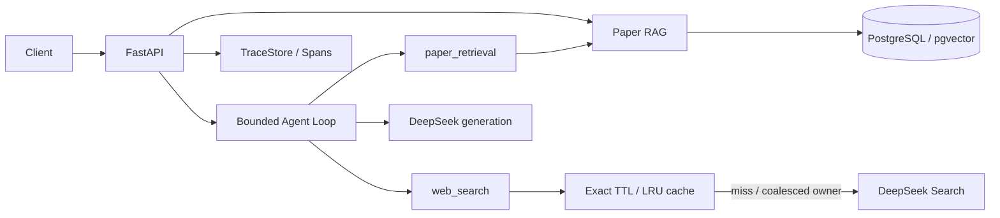

# Observable Agent Backend

[](https://github.com/260103990/observable-agent-backend/actions/workflows/tests.yml)

一个以论文阅读为应用场景、以外部搜索缓存为实验方向的 **Python Agent 后端**。实现论文 RAG、受控多轮 Tool Calling、Web Search、Trace/Span，以及可复现的精确搜索缓存实验。

关注的不只是模型回答，还包括数据如何持久化、工具如何受控执行、请求在哪里耗时，以及缓存究竟省掉了什么。当前是可运行的工程与研究实验基线；回答质量和生产部署仍有明确边界。

## 已实现

| 模块 | 实际能力 |
|---|---|
| 论文 RAG | PDF→清洗/切分→本地 Embedding→PostgreSQL/pgvector→单篇检索→DeepSeek→来源/PDF 页码引用 |
| Agent Loop | 原生工具协议、参数校验、多轮顺序调用、轮数/调用数/时间/上下文预算、有界错误恢复 |
| 工具 | `add_numbers`、`paper_retrieval`、可选 `web_search`；保留原单步 Agent API |
| 可观测性 | 请求 ID、阶段 Span、失败状态、模型/工具/Search 延迟、尝试次数、响应体字节、Cache Hit/Miss |
| Search 缓存 | 精确键、非滑动 TTL、LRU、容量预算、同 key 并发合并、取消传播、当前 Trace 与原来源关联 |
| 评估 | 无缓存/冷缓存/独立预热/热缓存，工具层与完整 Agent 分层，保留失败和质量待审状态 |

向量检索保持默认；可选 PostgreSQL 全文+向量 RRF 混合检索。回答聚焦提示实验默认关闭：真实结果未证明稳定收益，没有把实验写成已解决的质量问题。

## 架构



数据库保存论文、页面、Chunk/向量和 Trace；缓存只保存可复用的 Search 结果快照。Search 缓存不等于最终答案缓存，也不等于 RAG 检索缓存。

## 先运行测试，再体验 API

需要 Python 3.11。默认测试使用受控外部服务替身，不需要密钥、Ollama 或数据库。

```bash
git clone https://github.com/260103990/observable-agent-backend.git
cd observable-agent-backend
python -m venv .venv
# Linux/macOS: source .venv/bin/activate
# PowerShell: .\.venv\Scripts\Activate.ps1
python -m pip install -r requirements.txt
python -m pytest -q
python -m uvicorn app.main:app --host 127.0.0.1 --port 8000
```

打开 [Swagger UI](http://127.0.0.1:8000/docs)，或请求 `GET /health`。默认可以启动基础服务；模型接口需要另行配置对应服务，RAG/Web Search/缓存均默认关闭。

完整的 [快速启动](docs/quickstart.md) 包含本地模型、全新 pgvector 演示库初始化、论文上传/问答、Agent 请求及实验运行。

## HTTP 接口

| 接口 | 用途 |
|---|---|
| `GET /health` | 服务健康检查 |
| `POST /chat` | Ollama 文本生成 |
| `POST /agent/run` | 保留的 Ollama 单步工具调用 |
| `POST /agent/loop` | DeepSeek 受控多轮工具调用；可指定论文并显式请求 Web Search |
| `POST /papers` | multipart PDF 导入 |
| `POST /papers/{paper_id}/questions` | 指定论文问答与来源引用 |
| `GET /traces/{trace_id}` | 查询当前配置 TraceStore 中的执行记录 |

成功处理 HTTP 请求不一定表示任务完成：还应查看 `status`、`stop_reason`、`insufficient_evidence`。JSON 和引用 ID 合法也不代表每个事实都正确。

## 可以核对的验证结果

最近一次本地默认验证为 **691 passed、5 skipped、31 deselected**；真实测试数据库验证为 **25 passed、6 skipped**。默认测试包含单元与受控 ASGI 集成；数据库测试中的模型仍可为受控替身，真实外部服务结果另行记录。CI 在 Linux/Windows 上独立运行默认测试。

真实小样本缓存实验（2026-11-05）：

| 实验 | 观察结果 | 边界 |
|---|---|---|
| 完整 Search Agent | 无缓存 4 次问答产生 4 个 Search 请求；预热后 4 次问答产生 0 个 Search 请求 | 热阶段仍有 8 次 LLM 调用；预热另花 2 个 Search 请求 |
| 同 key 冷请求并发 | 4 并发×2轮：关闭合并 8 个 Search 请求；开启合并 2 个 | 6 次等待复用，TTL hits 均为 0；单进程、小样本 |

这些数据证明特定工作负载中确实减少了 Search 请求，不能直接写成稳定端到端加速或更高回答准确率。完整 Agent 的部分来源摘要在阶段间变化，因此未宣称严格可配对的因果加速。

查看 [实验协议、原始指标摘录与复现入口](docs/evaluation.md) 和 [验证层次与已知限制](docs/validation.md)。

## 设计要点与局限

- 导入按事务保存元数据、页面与 Chunk/向量；原文与规范化文本及字符范围可追溯，已保存论文按不可变导入处理。
- asyncpg pool 由 FastAPI lifespan 管理；请求借用资源，关闭和取消路径有测试。
- 只读且明确标记的瞬时错误才允许有限重试；不盲目重试有副作用工具。
- Search 默认使用提供方摘要，**没有抓取网页正文**；缓存命中保留原获取时间，TTL 不保证事实仍新鲜。
- 缓存与并发合并仅在单进程内共享；尚未实现 Redis、跨进程合并或语义缓存。
- 复杂 PDF 布局/图表可能影响召回，引用校验不等于语义蕴含；真实实验仍出现漏项、范围错误、资料不足和执行预算终止。
- 应用容器化、生产部署、独立质量盲评和大规模负载测试属于后续工作。

## 从哪里读代码

1. [架构与数据流](docs/architecture.md)：模块职责、表关系、事务、资源和错误路径。
2. [核心 Loop](app/agent/loop_runner.py)：模型决策、预算、工具执行和最终校验。
3. [持久化与检索](app/rag/store.py)：参数化 SQL、只读快照、余弦/可选混合检索。
4. [Search 缓存](app/tools/search_cache.py) / [并发合并](app/tools/search_coalescing.py)。
5. [面试讲解提纲](docs/interview.md)：围绕真实实现讲取舍，不把计划功能当作成果。

公开仓库只包含代码、测试、可复现工作负载和精选工程文档；密钥、论文文件、数据库与本地实验全文不随仓库提交。
